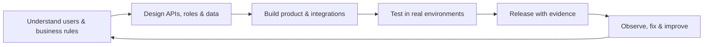

<!-- github-profile-readme: evidence-led public technical resume | updated 2026-11-13 -->

  

<h2 align="center">Technical Product Builder | Full-Stack & Mobile Platforms | Enterprise Systems</h2>

<strong>I build useful products, connect complex systems, and verify the work from design through release.</strong>

Based in Canada · 15+ years in enterprise delivery · TypeScript, React, APIs, data and mobile

  
  
  
  

---

<table>
<tr>
<td width="28%" valign="top" align="center">
   
  <strong>Product + engineering + delivery</strong> 
  Enterprise systems, practical software, and accountable releases
</td>
<td width="72%" valign="top">

### What I bring to a technical team

I work at the intersection of **software engineering, systems analysis, product ownership and release execution**. My focus is not only a feature that compiles, but an experience that users can operate, with clear data boundaries, maintainable integrations, and evidence that it works.

- **Build:** React, TypeScript, Next.js, React Native, Node.js, APIs and SQL.
- **Connect:** Supabase/PostgreSQL, cloud services, enterprise systems and practical integrations.
- **Validate:** API contracts, QA/UAT, physical-device tests, deployment verification and accessible UI.
- **Deliver:** product framing, scoped execution, handoff, incident diagnosis and iteration.

</td>
</tr>
</table>

## Selected products and engineering work

| Product or system | Engineering focus | Public evidence |
| --- | --- | --- |
| **PeacePad** | Co-parenting product, communication and shared-planning UX, React/TypeScript, mobile delivery, privacy-aware architecture | [Website](https://peacepad.ca/) · [App Store](https://apps.apple.com/ca/app/peacepad/id6793350735) · [Google Play](https://play.google.com/store/apps/details?id=ca.peacepad.family) |
| **Una Labs** | Technical product studio, Next.js, service workflows, integration and deployment operations | [Studio](https://unalabs.cloud/) · [What We Built](https://unalabs.cloud/work/) |
| **Anion** | Learning and scheduling platform flows, role-based operations and web services | [Product](https://anion.unalabs.cloud/) |
| **SayWetin** | Language and voice product experimentation, React and API-backed delivery | [Product](https://saywetin.app/) |
| **Dispatch** | Operational request routing and service workflow demonstration | [Public demo](https://unalabs.cloud/demo/dispatch/) |
| **CapSigma Growth Desk** | Lead-operations workflows, automation and evidence-aware handoff patterns | [Public surface](https://capsigma-growth-desk.pages.dev/) |
| **Garden Cleaners** | Service-business web presence, booking and customer workflow design | [Website](https://gardencleaners.ca/) |
| **Just Checking In** | Unity/C# game engineering and iOS build, signing and release-pipeline workflows | [Product overview](https://unalabs.cloud/products/) |

**Status matters:** These links point to independently accessible public product surfaces. Public availability does not guarantee that every named subsystem or future feature is released. Implementation details and customer data may live in private repositories.

## What the work demonstrates

<table>
<tr>
<td width="33%" valign="top">

### 01 · Product delivery

From a first user journey to responsive UI, integrations, App Store preparation, release checks and real feedback.

**React · Next.js · TypeScript · React Native · Capacitor**

</td>
<td width="33%" valign="top">

### 02 · Platform engineering

APIs, data modeling, service boundaries, secure authorization patterns and cloud/runtime choices appropriate to the workload.

**Node.js · Deno · Supabase · PostgreSQL · Cloudflare**

</td>
<td width="34%" valign="top">

### 03 · Enterprise execution

Translating business and data complexity into testable requirements, operational controls, acceptance evidence and reliable handoffs.

**POS · ERP · WMS · Data integration · QA/UAT · CI/CD**

</td>
</tr>
</table>

### Current engineering focus · November 2026

- **PeacePad consumer experience:** supporting the live website and publicly listed apps, with continuing responsive design, accessibility and release-quality improvements.
- **PeacePad Native V2:** React Native/Expo and backend integration work undergoing implementation and physical-device acceptance. **A separate Native V2 store release is not verified.**
- **Una Labs delivery:** building and maintaining public product experiences alongside private operational systems with explicit access boundaries.
- **Evidence-first engineering:** separating completed deployments, test builds, product concepts and blocked integrations rather than presenting them as equivalent.

For engineering decisions, architecture, release distinctions and selected public proof, see **[Technical Work: case studies and delivery approach](https://github.com/fefejiro/fefejiro/blob/main/TECHNICAL_WORK.md)**.

## Engineering toolkit

| Discipline | Tools and technologies |
| --- | --- |
| Full-stack applications | TypeScript, JavaScript, React, Next.js, Node.js, REST APIs |
| Mobile and desktop workflows | React Native, Expo, Capacitor, Android, iOS, Xcode, Unity/C# |
| Data and identity | PostgreSQL, SQL, Supabase, RLS, validation and access control |
| Cloud and delivery | Cloudflare, Railway, GitHub Actions, CI/CD, Docker, Terraform |
| Quality and observability | Playwright, Vitest, Jest, functional/UAT testing, release smoke checks |
| Enterprise and data | POS, ERP, WMS, data mapping, service integration, QA/UAT, rollout governance |
| AI-supported workflows | Human-approved assistants, integration boundaries, operational automation |

<strong>How I take software from idea to working delivery</strong>

The guiding principle: **a successful code change, a passing test, a deployed service and a usable release are different levels of evidence.**

## Public code, trust and case studies

| Resource | Why it is here |
| --- | --- |
| [Technical work and engineering case studies](https://github.com/fefejiro/fefejiro/blob/main/TECHNICAL_WORK.md) | Architecture, delivery practice, selected work and release status |
| [PeacePad public repository](https://github.com/fefejiro/PeacePad) | Historical public code and project background |
| [PeacePad privacy](https://github.com/fefejiro/peacepad-privacy) | Public privacy and trust documentation |
| [IT consulting background](https://github.com/fefejiro/fejiro-it-consulting) | Enterprise and technical delivery positioning |
| [Public portfolio](https://unalabs.cloud/work/) | Product experiences that visitors can actually open |
| [GitHub account overview](https://github.com/fefejiro) | Account-level public repositories and native contribution activity |

## Contribution trail

**An updated visual built from GitHub's public contribution calendar on November 13, 2026.** A moving marker follows days with recorded activity. For current totals and the native activity timeline, use the [GitHub account overview](https://github.com/fefejiro).

<picture>
  <source media="(prefers-color-scheme: dark)" srcset="https://raw.githubusercontent.com/fefejiro/fefejiro/output/github-contribution-grid-snake-dark.svg"/>
  <source media="(prefers-color-scheme: light)" srcset="https://raw.githubusercontent.com/fefejiro/fefejiro/output/github-contribution-grid-snake.svg"/>
  
</picture>

Public graph only. Work in private repositories is not fully represented unless GitHub's optional anonymized private-contributions setting is enabled. This display is not an all-repository commit count.

<strong>Why the profile repository shows zero open issues or pull requests</strong>

GitHub's issue and pull-request counters on `fefejiro/fefejiro` describe **open items in this one profile repository**. They do not summarize projects, commits, issue history, merged pull requests or private work across the account.

For a more useful picture, open the [account profile](https://github.com/fefejiro), [public repositories](https://github.com/fefejiro?tab=repositories), [pull-request history for this profile](https://github.com/fefejiro/fefejiro/pulls?q=is%3Apr) or [merged profile improvement PR #7](https://github.com/fefejiro/fefejiro/pull/7). Private commercial source repositories remain private by design.

---

  <strong>From product concept to accountable release.</strong> 
  <a href="https://unalabs.cloud/work/">Explore the work</a> ·
  <a href="https://www.linkedin.com/in/fejiro-efiuvwere">LinkedIn</a> ·
  <a href="mailto:fejiro@peacepad.ca">fejiro@peacepad.ca</a>

Public technical résumé, updated November 13, 2026. No confidential code, family information or customer records are published here.

